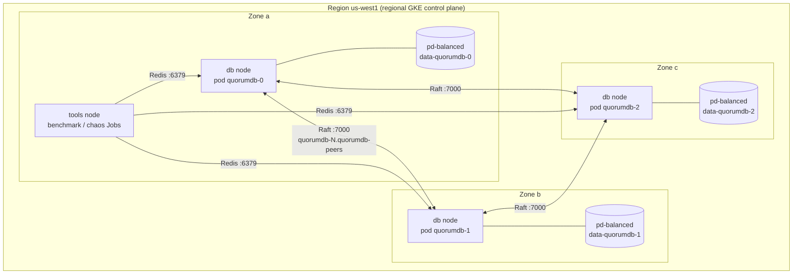

# QuorumDB on GKE: design notes

How QuorumDB runs on Google Kubernetes Engine across three zones, why each piece is there, and what it costs. The Raft implementation itself is unchanged; see the README for how it works.

## 1. Infrastructure (Terraform)

### What was built

All GCP resources are in [`infra/terraform/`](infra/terraform/), one file per concern:

| File | Creates |
|---|---|
| `providers.tf` | Google provider, state in a GCS bucket (bucket name passed at `terraform init`) |
| `variables.tf` | `project_id`, `region` (default `us-west1`), `machine_type` (default `e2-standard-2`) |
| `apis.tf` | Enables the Compute, Kubernetes Engine and Artifact Registry APIs |
| `network.tf` | A custom VPC and one regional subnet, with secondary ranges for pod and Service IPs |
| `artifact_registry.tf` | A Docker repository in the same region |
| `cluster.tf` | A regional GKE cluster in the region's first three zones, with Dataplane V2 |
| `node_pools.tf` | `db`: one `e2-standard-2` per zone (3 nodes). `tools`: one node for benchmark and chaos clients |
| `service_account.tf` | A node service account with GKE's minimum node role and read access to the image repository |

`scripts/push-image.sh` builds the image for `linux/amd64` and pushes it, tagged with the git commit.

### Why

- **Three zones, one node each.** A zone is a separate failure domain: its own power, cooling and network. Raft needs a majority (2 of 3), so with one node per zone, losing any single zone leaves a working cluster. Two nodes in one zone would mean that zone's failure takes out the majority.
- **Regional cluster.** The location is the region, so GKE runs the Kubernetes control plane in every zone. If the leader's zone fails, the API server is still up to reschedule pods and serve `kubectl`.
- **Dataplane V2.** GKE's eBPF dataplane (built on Cilium) enforces Kubernetes NetworkPolicy without installing Calico. The chaos test uses NetworkPolicy to cut links between zones.
- **VPC-native networking.** Pods get IPs from a secondary range of the subnet, so traffic between pods in different zones is routed directly by the VPC with no overlay. Dataplane V2 requires this.
- **A separate tools node.** `redis-benchmark` with 50 connections uses a lot of CPU. On a 2-vCPU database node, it would compete with QuorumDB and the results would measure that competition.
- **Remote state.** Terraform state in GCS survives a lost laptop and is locked while an apply runs.
- **Image built on the laptop.** `docker buildx` cross-compiles Go for amd64, which is fast and needs no Cloud Build setup.

### Tradeoffs

- **Regional cluster fee.** GKE charges a management fee per cluster, and its free tier covers zonal and Autopilot clusters but not regional ones. A zonal cluster with nodes in three zones would be free, but its control plane would live in one zone.
- **Nodes have public IPs.** Private nodes are more secure but need Cloud NAT to reach the internet, which is another billed resource. The workloads here only talk to each other and to Google APIs, so public nodes keep the setup small.
- **e2-standard-2 is small.** 2 vCPUs (shared hyperthreads) and 8 GB. It is cheap, and with Raft every write waits on two disk flushes, so CPU is not the first bottleneck. The numbers would be higher on bigger machines.
- **pd-balanced disks.** These are network-attached disks, so each fsync is a network round trip. Local SSDs would be faster but lose data when a VM is stopped, which defeats the point of a write-ahead log.
- **`remove_default_node_pool`.** Provider 8 deprecates it, because GKE 1.36.4+ can create a cluster with no default pool. The deprecated way works on every GKE version the release channel might pick.

### Interview questions

**Why three zones and not two?**
Raft needs a majority. With two zones, one zone has at least two of the three nodes, and losing that zone loses the majority. With three zones and one node each, any one zone can fail.

**What happens to writes if a whole zone goes down?**
If it was a follower's zone, nothing visible: the leader still has a majority (itself plus the other follower). If it was the leader's zone, the two remaining nodes stop hearing heartbeats, elect a new leader after a randomized 300–600 ms timeout, and continue. Writes that were in flight on the old leader get an "outcome unknown" error, never a false OK.

**Why a dedicated node service account?**
The default Compute Engine account often has the Editor role on the whole project, so any pod that reached the metadata server could act with it. The dedicated account can only write logs and metrics and pull from one repository.

## 2. Kubernetes

### What was built

Plain manifests in [`deploy/k8s/base/`](deploy/k8s/base/), combined with kustomize:

| File | What it is |
|---|---|
| `namespace.yaml` | The `quorumdb` namespace |
| `peers-service.yaml` | Headless Service `quorumdb-peers`: a stable DNS name per pod, for Raft traffic |
| `statefulset.yaml` | 3 replicas, one PVC each, one pod per zone, probes, config from environment variables |
| `client-service.yaml` | Service `quorumdb` on port 6379 for applications |
| `pod-disruption-budget.yaml` | At most one pod down for voluntary disruptions |

`scripts/gke-deploy.sh` writes a small overlay in `.deploy/` that sets the image registry and tag, then runs `kubectl apply -k` and waits for the rollout.



### Why

- **StatefulSet, not Deployment.** Raft membership is fixed: every node must keep the same ID, the same address and the same log across restarts. A StatefulSet gives each pod a fixed name (`quorumdb-0`, used as its Raft ID), a fixed DNS name, and its own PersistentVolumeClaim that is reattached whenever the pod is recreated.
- **Headless Service with `publishNotReadyAddresses`.** DNS records exist even for pods that are not ready. A node only becomes ready after it finds a leader, and it needs its peers' names to elect one. Without this setting, a fresh cluster could never start.
- **`podManagementPolicy: Parallel`.** The default starts `quorumdb-1` only after `quorumdb-0` is ready, which never happens with one node. Parallel starts all three. It also means a pod that is down or frozen does not block the controller from recreating another one.
- **Zone spread.** `topologySpreadConstraints` with `maxSkew: 1` on `topology.kubernetes.io/zone` makes the scheduler place exactly one pod per zone. `DoNotSchedule` leaves a pod pending rather than putting two in one zone, which would make that zone a single point of failure for the majority.
- **`ReadWriteOncePod` disks.** Only one pod in the whole cluster can mount a disk at a time. Two processes appending to the same write-ahead log would corrupt it, and this rules that out even during a messy restart.
- **Probes.** Readiness is "knows the current leader", so the client Service only routes to nodes that can serve. Liveness only checks that the process answers, and allows 30 seconds, because restarting a slow but healthy node would make things worse. A startup probe gives log replay up to 5 minutes.
- **PodDisruptionBudget, `maxUnavailable: 1`.** GKE node upgrades drain nodes. The budget makes them go one node at a time, so two nodes (a majority) are always up.
- **No CPU limit.** A CPU limit is enforced by pausing the container for the rest of a 100 ms scheduling period, which could delay heartbeats. The pod requests 1 CPU, so it is guaranteed that much. It has a memory limit so a leak cannot take down the node.
- **Non-root and tini.** The process runs as UID 10001, and `fsGroup` makes the volume writable for it. tini as PID 1 forwards SIGTERM for a clean shutdown and lets the chaos test send SIGSTOP and SIGKILL to the server.

### Tradeoffs

- **A pod is pinned to its zone.** A zonal persistent disk can only attach to a VM in its own zone. If a whole zone goes down, that pod cannot move, and the cluster runs on two nodes until the zone returns. Regional persistent disks replicate synchronously to a second zone so the pod could move, but each fsync would then wait on a cross-zone write. Raft already keeps three copies in three zones.
- **Readiness depends on the cluster.** If a majority is lost, every node becomes unready and the client Service has no endpoints. That is correct (no node can commit writes), but it means readiness is not a per-pod health signal.
- **Fixed membership.** Scaling the StatefulSet to 5 replicas would not add Raft members, because the peer list is static. Changing membership at runtime is on the roadmap.
- **In-cluster only.** The client Service is a ClusterIP. Exposing it outside the cluster would need a load balancer, and the Redis protocol here has no AUTH or TLS.

### Cost and teardown

What `make up` creates that is billed while it exists:

- the GKE cluster management fee (regional clusters are not covered by the GKE free tier),
- four `e2-standard-2` VMs (three db, one tools) and their 30 GB boot disks,
- three 10 GiB `pd-balanced` disks for the PVCs,
- an external IP per node,
- traffic between zones (Raft sends every write to two other zones),
- image storage in Artifact Registry, and logs in Cloud Logging.

Check current prices with the [Google Cloud pricing calculator](https://cloud.google.com/products/calculator). Run `make down` as soon as the tests are finished.

`make down` deletes the `quorumdb` namespace first and waits for the three PVC disks to be deleted, then runs `terraform destroy`. The order matters: GKE created those disks, not Terraform, so destroying the cluster first would leave them behind, still billed. Afterwards, these should print nothing:

```bash
gcloud container clusters list
gcloud compute disks list --filter="name~^pvc-"
gcloud compute instances list
```

The Terraform state bucket is the one thing left. It holds a few KB; delete it with `gcloud storage rm -r gs://<project>-quorumdb-tfstate`.

### Interview questions

**Why not a Deployment with a volume?**
Deployment pods get random names and share one PVC template, so a pod's identity and disk are not tied together. Raft needs node `quorumdb-1` to always come back with `quorumdb-1`'s log. A StatefulSet guarantees that pairing, and creates the replacement only after the old pod is gone.

**A node VM dies. What happens?**
Raft first: the other two nodes still form a majority. If the dead node was the leader, they elect a new one within a randomized 300–600 ms timeout. Then Kubernetes: the pod's disk is zonal, so the pod can only restart in the same zone. With one db node per zone, it stays pending until GKE auto-repairs or replaces the VM. Then it reattaches its disk, replays its log, and the leader sends it whatever it missed.

**Why is readiness "knows a leader" and not just "process is up"?**
Readiness decides who gets client traffic. A node with no leader (cut off from the majority, or mid-election) can neither commit writes nor serve linearizable reads, so routing clients there only produces timeouts. Liveness is the "process is up" check, and it is kept loose so Kubernetes does not restart nodes that are healthy but waiting for an election.

## 3. Benchmarks

### What was built

- [`cmd/benchmark`](cmd/benchmark/main.go): asks each node for its Raft role, then runs the official `redis-benchmark` (`-t set,get -n 200000 -c 50 -r 100000 -d 3 --csv`) three times for each of three settings: the leader with no pipelining, the leader with 16 commands per round trip, and a follower with no pipelining. Each run is saved with the node it targeted and whether the leader changed during it.
- `make bench` runs it in a container on the local Docker cluster's network and writes `results/local/benchmark.json`.
- [`deploy/k8s/benchmark/`](deploy/k8s/benchmark/): a Job that runs the same tool on the tools node against the pods' DNS names. A read-only service account lets it record which zone and machine type each pod and the client ran on. `make gke-bench` runs it and saves `results/gke/benchmark.json`.
- `cmd/results` (section 5) turns both files into the README table: the median of the three runs, with the range.

### Why

- **The client runs inside the cluster.** From a laptop, traffic would go through `kubectl port-forward` and the Kubernetes API server, and the benchmark would measure that tunnel. Inside the cluster, the client reaches pod IPs directly, as an application would.
- **The same tool locally and on GKE.** Both columns of the table come from the same code, the same flags and the same `redis-benchmark` version (the one in the tools image), so the only differences are the machines and the network.
- **Interleaved repeats.** Each repeat runs all three settings before the next repeat starts. If the disk warms up or the dataset grows during the session, every setting is affected equally rather than only the last one measured.
- **Placement is recorded, not assumed.** The leader is whichever node won the last election, so whether the client and the leader share a zone changes between sessions. The JSON says where each one was.
- **Results leave through the log.** The Job prints its JSON between marker lines at the end of its log, and the script cuts it out. No storage bucket, volume or `kubectl cp` is needed, and the log stays readable until the next run deletes the Job.

### Tradeoffs

- **One client machine.** With `-P 16`, the leader may answer faster than a single 2-vCPU client can send, so those rows can measure the client rather than the database.
- **Closed-loop load.** `redis-benchmark` sends a new request only after the previous one is answered. When the server slows down, the offered load drops with it, so tail latency under a fixed request rate would be worse than these percentiles. This is often called coordinated omission.
- **Three repeats.** Enough to see the spread, not enough for confidence intervals. The table shows the range, not a standard deviation.
- **Shared-core VMs.** e2 machines share physical cores with other customers' VMs, so results can vary between sessions.

### Interview questions

**What limits write throughput on GKE?**
Each write is acknowledged only after it is on disk on two of three nodes: the leader's own fsync, plus one follower's fsync and its reply across zones. Writes from many clients are batched into one AppendEntries and one fsync (group commit), so throughput depends on how many writes fit into one round of `fsync + cross-zone round trip`. That is why pipelining raises throughput so much.

**Why are reads through a follower slower than through the leader?**
A follower forwards every command to the leader over a second connection and relays the reply, which adds a network hop, usually across zones. On the leader, a read needs only a ReadIndex heartbeat round, with no disk write.

**Why did you not just report the best run?**
The best run hides variance, and the variance is real: shared VMs, network jitter, background snapshots. The median of three with the full range is honest about it, and the raw runs are in the JSON for anyone who wants to check.
