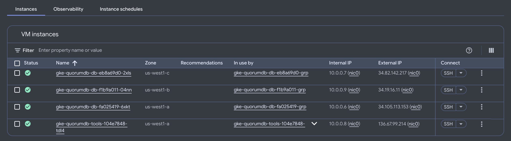
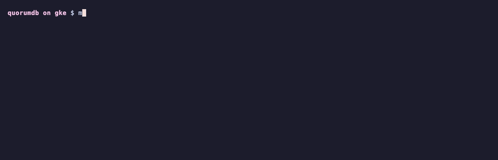

<div align="center">


# QuorumDB

**A database that keeps every piece of data on three computers, so it keeps working when one of them fails.**

[](go.mod)
[](internal/resp/resp.go)
[](infra/terraform/cluster.tf)
[](LICENSE)

<br>


</div>

## ✨ What it does

- **Keeps three copies of everything.** You only get "OK" back once at least two of the three computers have saved your data.
- **Keeps going when a computer fails.** If one crashes, freezes or loses its network, the other two carry on.
- **Never gives you out-of-date data.**
- **Works with Redis tools**, because it speaks the same language as Redis, a popular database.
- **Runs on Google Cloud** with each computer in a different data center.

I built the part that keeps the three copies in agreement myself, following a method called Raft.

## 🔬 How it works

One computer is the leader. When you save something, the leader sends it to the other two and replies "OK" once two of the three have it on disk. If the leader goes quiet for about half a second, the other two vote for a new leader. A computer that crashes reads its saved data when it comes back, then catches up on what it missed.

More detail, and the choices I made: [DESIGN.md](DESIGN.md).

## 📊 Results

The chaos test breaks things on purpose while data is being saved: it crashes computers, freezes them and cuts their network, 100 times. Then it checks that nothing was lost and every answer was right. All numbers come from the files in [`results/`](results/).

Google Cloud is slower because each copy is in a different data center, so every save has to travel between buildings before it gets "OK". On my laptop all three copies run on the same machine.

<!-- results:begin (generated by `make results` from results/*.json; do not edit by hand) -->

**Chaos test**

| | On my laptop | On Google Cloud |
|---|---|---|
| Runs where every check passed | **100 / 100** | **100 / 100** |
| Saves that got "OK" but were lost | **0** of 87,994 | **0** of 578,289 |
| Wrong answers found | **0** | **0** |
| Problems caused on purpose | 626 | 503 |
| Time to pick a new leader | 489 ms typical, 1,109 ms slowest | 817 ms typical, 2,782 ms slowest |

To check the test itself, I also ran it against two versions I broke on purpose. It caught them in 10 of 10 runs and 10 of 10 runs.

**Speed test**

| | On my laptop | On Google Cloud |
|---|---|---|
| Saves per second | 25,294 | 8,455 |
| Reads per second | 82,169 | 20,173 |
| Saves per second, sending 16 at a time | 167,504 | 55,371 |
| Typical time for one save | 1.58 ms | 5.08 ms |
| Typical time for one read | 0.44 ms | 1.90 ms |

Middle result of 3 runs of `redis-benchmark`, sent to the leader from 50 connections. The files in [`results/`](results/) have every run, the slowest times and the full setup.

<!-- results:end -->

## ⚡️ Run it

With Docker installed:

```bash
make cluster-up                        # start the three computers
redis-cli -p 6379 SET user:42 alice    # save on one
redis-cli -p 6381 GET user:42          # read from another: "alice"
make kill-leader                       # crash the leader; a new one takes over
make chaos                             # run the chaos test
```

## ☁️ On Google Cloud

The three copies run on Google Cloud, each in a different data center (zone) in the `us-west1` region:



Here I save a value, then crash the leader. A copy in another data center takes over, the crashed one comes back and catches up, and all three still have the value:



To set it up yourself, see [the steps in DESIGN.md](DESIGN.md#running-it-on-google-cloud-for-the-first-time).

## 💡 Things I learned

- **Check that the problem you caused really happened.** On Google Cloud, my network cuts silently did nothing: Google's network ignores the name tag my rules used to pick a pod. Timing how long a new leader took to appear is what revealed it.
- **Test the old version before blaming the new one.** My speed results dropped after a change. The old version was just as slow: the laptop's Low Power Mode was on.
- **A crash test has to be a real crash.** Asking a program to stop lets it save everything first. To test crash recovery, the test has to kill it instantly.

## 📄 License

[MIT](LICENSE)
